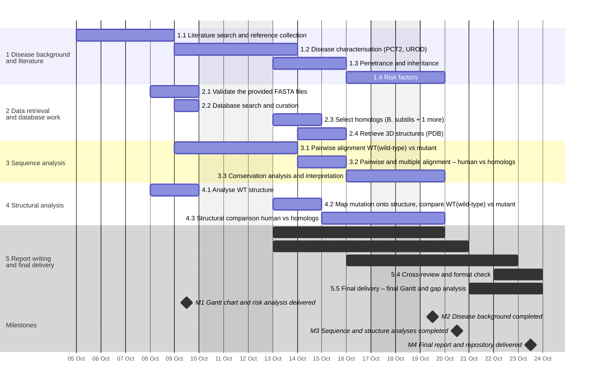

# Gantt Chart — Porphyria Cutanea Tarda Type 2 (PCT2) — Frozen version 9/10

Planned schedule for 5–23 October 2026, with tasks assigned to Sara, Eva, Lídia and Laia. Durations count working days only (Monday to Friday); Monday 12 October is a public holiday in Spain and is shaded in the original chart.

## Project information

### General objective

The project aims to investigate how changes in gene and protein sequences and structures contribute to the molecular basis of Porphyria Cutanea Tarda Type 2 (PCT), as well as to explore how comparative analysis of these sequences provides insights into the affected biological functions.

### Specific objectives

1. Learn what PCT type 2 is and which gene and protein are involved.
2. Collect the sequences and structures we need: the 4 FASTA files, the database records, at least 2 homologs (including _B. subtilis_) and the 3D structures.
3. Find the mutation by comparing the WT and mutant sequences, and check if it is conserved in the homologs.
4. Look at where the mutation is in the 3D structure and compare the WT and mutant proteins.
5. Write the final report on GitHub with contributions from all four members.

### Milestones

| ID  | Milestone                                 |    Date    |
| --- | ----------------------------------------- | :--------: |
| M1  | Gantt chart and risk analysis delivered   | 9 October  |
| M2  | Disease background completed              | 19 October |
| M3  | Sequence and structure analyses completed | 20 October |
| M4  | Final report and repository delivered     | 23 October |

### Project members

- **Sara Charif Karkri el Abbassi** (_Undergraduate Student in Bioinformatics_) – Project Manager, Data & Database Specialist: Responsible for defining scope, timeline tracking, Gantt chart management, and repository oversight. FASTA validation, database curation, homolog selection, and PDB retrieval.
- **Laia Núñez Palma** (_Undergraduate Student in Bioinformatics_) – Disease & Literature Specialist: Responsible for the biological foundation of the project: literature search and reference management, characterisation of PCT type 2 (UROD gene, protein and heme pathway), and analysis of penetrance, inheritance and risk factors.
- **Eva Rodríguez García** (_Undergraduate Student in Bioinformatics_) – Structural Analyst: Responsible for analysing the WT structure, mapping mutations onto the structure, comparing WT (wild-type) and mutant structures, and performing structural comparisons between human proteins and their homologs.
- **Lídia Riba Garcia** (_Undergraduate Student in Bioinformatics_) – Sequence Analyst: Responsible for sequence analysis, including pairwise alignment of WT(wild-type) vs mutant sequences, pairwise and multiple alignment of human vs homologs, and conservation analysis and interpretation.

## Timeline

Bars are drawn from the planned start and end dates (end date included). Diamonds mark the milestones M1–M4. Shaded days are weekends and the 12 October holiday.

## Dates, owners and progress

| ID    | Task title                                                   | Task owner                | Planned start date | Planned end date | Real start date | Real end date | Duration (days) |  Predecessor  | PCT of task complete |
| ----- | ------------------------------------------------------------ | ------------------------- | :----------------: | :--------------: | :-------------: | :-----------: | :-------------: | :-----------: | :------------------: |
| **1** | **Disease background and literature**                        |                           |                    |                  |                 |               |                 |               |                      |
| 1.1   | Literature search and reference collection                   | Laia                      |      5/10/26       |     8/10/26      |        -        |       -       |        4        |       -       |          0%          |
| 1.2   | Disease characterisation (PCT2, UROD)                        | Laia                      |      9/10/26       |     13/10/26     |        -        |       -       |        2        |      1.1      |          0%          |
| 1.3   | Penetrance and inheritance                                   | Laia                      |      13/10/26      |     15/10/26     |        -        |       -       |        3        |   1.1, 1.2    |          0%          |
| 1.4   | Risk factors                                                 | Laia                      |      16/10/26      |     19/10/26     |        -        |       -       |        2        | 1.1, 1.2, 1.3 |          0%          |
| **2** | **Data retrieval and database work**                         |                           |                    |                  |                 |               |                 |               |                      |
| 2.1   | Validate the provided FASTA files                            | Sara                      |      8/10/26       |     9/10/26      |        -        |       -       |        2        |       -       |         10%          |
| 2.2   | Database search and curation                                 | Sara                      |      9/10/26       |     9/10/26      |        -        |       -       |        1        |      2.1      |          0%          |
| 2.3   | Select homologs (_B. subtilis_ + 1 more)                     | Sara                      |      13/10/26      |     14/10/26     |        -        |       -       |        2        |      2.2      |          0%          |
| 2.4   | Retrieve 3D structures (PDB)                                 | Sara                      |      14/10/26      |     15/10/26     |        -        |       -       |        2        |      2.2      |          0%          |
| **3** | **Sequence analysis**                                        |                           |                    |                  |                 |               |                 |               |                      |
| 3.1   | Pairwise alignment WT(wild-type) vs mutant                   | Lídia                     |      9/10/26       |     13/10/26     |        -        |       -       |        2        |      2.1      |          0%          |
| 3.2   | Pairwise and multiple alignment: human vs homologs           | Lídia                     |      14/10/26      |     15/10/26     |        -        |       -       |        2        |   2.3, 3.1    |          0%          |
| 3.3   | Conservation analysis and interpretation                     | Lídia                     |      16/10/26      |     19/10/26     |        -        |       -       |        2        |      3.2      |          0%          |
| **4** | **Structural analysis**                                      |                           |                    |                  |                 |               |                 |               |                      |
| 4.1   | Analyse WT structure                                         | Eva                       |      8/10/26       |     9/10/26      |        -        |       -       |        2        |      2.4      |          0%          |
| 4.2   | Map mutation onto structure, compare WT(wild-type) vs mutant | Eva                       |      13/10/26      |     14/10/26     |        -        |       -       |        2        |   3.1, 4.1    |          0%          |
| 4.3   | Structural comparison human vs homologs                      | Eva                       |      15/10/26      |     19/10/26     |        -        |       -       |        3        |      4.2      |          0%          |
| **5** | **Report writing and final delivery**                        |                           |                    |                  |                 |               |                 |               |                      |
| 5.1   | Draft Background / Introduction                              | Sara, Eva, Lídia and Laia |      13/10/26      |     19/10/26     |        -        |       -       |        5        |   1.3, 1.4    |          0%          |
| 5.2   | Draft Methods and Results: structure                         | Sara, Eva, Lídia and Laia |      13/10/26      |     20/10/26     |        -        |       -       |        6        |   3.3, 4.3    |          0%          |
| 5.3   | Draft Discussion, Conclusions and Abstract                   | Sara, Eva, Lídia and Laia |      16/10/26      |     22/10/26     |        -        |       -       |        5        |      5.2      |          0%          |
| 5.4   | Cross-review and format check                                | Sara, Eva, Lídia and Laia |      22/10/26      |     23/10/26     |        -        |       -       |        2        |      5.3      |          0%          |
| 5.5   | Final delivery: final Gantt and gap analysis                 | Sara, Eva, Lídia and Laia |      21/10/26      |     23/10/26     |        -        |       -       |        3        |      5.4      |          0%          |

## Outputs and completion criteria

| ID    | Task title                                                   | Output                                                          | Accomplished when                                                                                                                                  |
| ----- | ------------------------------------------------------------ | --------------------------------------------------------------- | -------------------------------------------------------------------------------------------------------------------------------------------------- |
| **1** | **Disease background and literature**                        |                                                                 |                                                                                                                                                    |
| 1.1   | Literature search and reference collection                   | Reference list                                                  | At least 5 reliable sources are saved as PDFs and listed with a short comment on each one.                                                         |
| 1.2   | Disease characterisation (PCT2, UROD)                        | Disease and gene profile                                        | The summary explains the disease, the affected gene and protein, and their role in the heme pathway, with citations.                               |
| 1.3   | Penetrance and inheritance                                   | Inheritance and penetrance overview                             | The summary explains how the disease is inherited and why a carrier may not develop it, with citations.                                            |
| 1.4   | Risk factors                                                 | Risk factor table                                               | The table lists at least 3 risk factors, each with a short explanation and a source.                                                               |
| **2** | **Data retrieval and database work**                         |                                                                 |                                                                                                                                                    |
| 2.1   | Validate the provided FASTA files                            | Validated FASTA files                                           | All provided FASTA files are verified for sequence integrity, valid headers, and clean formatting.                                                 |
| 2.2   | Database search and curation                                 | Curated gene and protein dataset                                | Target gene and protein datasets are retrieved from UniProt/NCBI, curated, and saved in the repository.                                            |
| 2.3   | Select homologs (_B. subtilis_ + 1 more)                     | Homologous sequences list                                       | Homologous sequences for _B. subtilis_ and a second reference (to be determined) species are identified and confirmed.                             |
| 2.4   | Retrieve 3D structures (PDB)                                 | Downloaded PDB structure files                                  | Experimental or predicted 3D PDB structure files are downloaded for wild-type and target variants.                                                 |
| **3** | **Sequence analysis**                                        |                                                                 |                                                                                                                                                    |
| 3.1   | Pairwise alignment WT(wild-type) vs mutant                   | Annotated WT vs Mutant alignment                                | The WT and mutant sequences are aligned and the mutation is identified at DNA and amino acid level and documented.                                 |
| 3.2   | Pairwise and multiple alignment: human vs homologs           | Multiple sequence alignment files                               | Human sequences are aligned with the selected homologs (_B. subtilis_ + 1 more), and the alignment files are saved in the repository.              |
| 3.3   | Conservation analysis and interpretation                     | Conservation plot and summary                                   | Conserved regions and the mutated positions are identified, and their biological meaning is explained with citations.                              |
| **4** | **Structural analysis**                                      |                                                                 |                                                                                                                                                    |
| 4.1   | Analyse WT structure                                         | Annotated 3D structure report & figures                         | The WT structure is successfully analysed and the main structural features relevant to the study are identified and documented.                    |
| 4.2   | Map mutation onto structure, compare WT(wild-type) vs mutant | Structural superposition of WT and mutant                       | The mutation is correctly mapped onto the structure, and the WT and mutant structures are compared to identify relevant structural differences.    |
| 4.3   | Structural comparison human vs homologs                      | Multi-species 3D structural alignment & figures                 | The human structure is compared with the structures of selected homologs, and the main similarities and differences are identified and documented. |
| **5** | **Report writing and final delivery**                        |                                                                 |                                                                                                                                                    |
| 5.1   | Draft Background / Introduction                              | Introduction section draft in report md                         | The disease background, clinical context (PCT2, UROD), and scope are fully written in report md                                                    |
| 5.2   | Draft Methods and Results: structure                         | Methods and Results draft sections with embedded figures        | All methodology protocols, sequence alignment figures, and 3D structural models are documented in report md                                        |
| 5.3   | Draft Discussion, Conclusions and Abstract                   | Complete draft of Abstract, Discussion, and Conclusion sections | Biological implications, limitations, evolutionary insights, and summary abstract are integrated into report md                                    |
| 5.4   | Cross-review and format check                                | review log & formatted report                                   | Markdown rendering, figure links, and citations are verified.                                                                                      |
| 5.5   | Final delivery: final Gantt and gap analysis                 | Final GitHub commit & Project Status                            | Final Gantt, gap analysis, and repository are committed and live on GitHub.                                                                        |

## Day-by-day chart

Weeks of 5–9, 12–16 and 19–23 October 2026; M T W R F = Monday to Friday (R = Thursday). 🟦 🟧 🟩 🟨 🟪 = planned day of phases 1 to 5 (same colours as the timeline); ░ = Monday 12 October (holiday).

| ID    | Task title                                                   | M 5 | T 6 | W 7 | R 8 | F 9 | M 12 | T 13 | W 14 | R 15 | F 16 | M 19 | T 20 | W 21 | R 22 | F 23 |
| ----- | ------------------------------------------------------------ | :----: | :----: | :----: | :----: | :----: | :-----: | :-----: | :-----: | :-----: | :-----: | :-----: | :-----: | :-----: | :-----: | :-----: |
| **1** | **Disease background and literature**                        |        |        |        |        |        |         |         |         |         |         |         |         |         |         |         |
| 1.1   | Literature search and reference collection                   |   🟦   |   🟦   |   🟦   |   🟦   |        |    ░    |         |         |         |         |         |         |         |         |         |
| 1.2   | Disease characterisation (PCT2, UROD)                        |        |        |        |        |   🟦   |    ░    |   🟦    |         |         |         |         |         |         |         |         |
| 1.3   | Penetrance and inheritance                                   |        |        |        |        |        |    ░    |   🟦    |   🟦    |   🟦    |         |         |         |         |         |         |
| 1.4   | Risk factors                                                 |        |        |        |        |        |    ░    |         |         |         |   🟦    |   🟦    |         |         |         |         |
| **2** | **Data retrieval and database work**                         |        |        |        |        |        |         |         |         |         |         |         |         |         |         |         |
| 2.1   | Validate the provided FASTA files                            |        |        |        |   🟧   |   🟧   |    ░    |         |         |         |         |         |         |         |         |         |
| 2.2   | Database search and curation                                 |        |        |        |        |   🟧   |    ░    |         |         |         |         |         |         |         |         |         |
| 2.3   | Select homologs (_B. subtilis_ + 1 more)                     |        |        |        |        |        |    ░    |   🟧    |   🟧    |         |         |         |         |         |         |         |
| 2.4   | Retrieve 3D structures (PDB)                                 |        |        |        |        |        |    ░    |         |   🟧    |   🟧    |         |         |         |         |         |         |
| **3** | **Sequence analysis**                                        |        |        |        |        |        |         |         |         |         |         |         |         |         |         |         |
| 3.1   | Pairwise alignment WT(wild-type) vs mutant                   |        |        |        |        |   🟩   |    ░    |   🟩    |         |         |         |         |         |         |         |         |
| 3.2   | Pairwise and multiple alignment: human vs homologs           |        |        |        |        |        |    ░    |         |   🟩    |   🟩    |         |         |         |         |         |         |
| 3.3   | Conservation analysis and interpretation                     |        |        |        |        |        |    ░    |         |         |         |   🟩    |   🟩    |         |         |         |         |
| **4** | **Structural analysis**                                      |        |        |        |        |        |         |         |         |         |         |         |         |         |         |         |
| 4.1   | Analyse WT structure                                         |        |        |        |   🟨   |   🟨   |    ░    |         |         |         |         |         |         |         |         |         |
| 4.2   | Map mutation onto structure, compare WT(wild-type) vs mutant |        |        |        |        |        |    ░    |   🟨    |   🟨    |         |         |         |         |         |         |         |
| 4.3   | Structural comparison human vs homologs                      |        |        |        |        |        |    ░    |         |         |   🟨    |   🟨    |   🟨    |         |         |         |         |
| **5** | **Report writing and final delivery**                        |        |        |        |        |        |         |         |         |         |         |         |         |         |         |         |
| 5.1   | Draft Background / Introduction                              |        |        |        |        |        |    ░    |   🟪    |   🟪    |   🟪    |   🟪    |   🟪    |         |         |         |         |
| 5.2   | Draft Methods and Results: structure                         |        |        |        |        |        |    ░    |   🟪    |   🟪    |   🟪    |   🟪    |   🟪    |   🟪    |         |         |         |
| 5.3   | Draft Discussion, Conclusions and Abstract                   |        |        |        |        |        |    ░    |         |         |         |   🟪    |   🟪    |   🟪    |   🟪    |   🟪    |         |
| 5.4   | Cross-review and format check                                |        |        |        |        |        |    ░    |         |         |         |         |         |         |         |   🟪    |   🟪    |
| 5.5   | Final delivery: final Gantt and gap analysis                 |        |        |        |        |        |    ░    |         |         |         |         |         |         |   🟪    |   🟪    |   🟪    |

## Risk analysis

### Score calculation

Risk = Likelihood × Impact

| Score | Category |
| :---: | :------: |
|  1–2  |   Low    |
|  3–5  |  Medium  |
|  6–9  |   High   |

### Risks

| Risk                              | Why                                                                                                                             | Likelihood | Impact | Score | Category | Contingency                                                                                                                                           |
| --------------------------------- | ------------------------------------------------------------------------------------------------------------------------------- | :--------: | :----: | :---: | :------: | ----------------------------------------------------------------------------------------------------------------------------------------------------- |
| Delays due to compressed schedule | The project has a short timeframe and several tasks depend on previous outputs.                                                 |     2      |   3    |   6   |   High   | Organise the tasks so that they run in parallel and check the Gantt every week.                                                                       |
| Problems with GitHub              | The final report and project files depend on the repository being accessible and correctly maintained.                          |     3      |   1    |   3   |  Medium  | Keep a backup copy of all the files on our computers and share a document with the project information, so that nothing is lost if GitHub fails.      |
| Unreliable sources or databases   | Biological information may differ between sources or some databases may contain incomplete or outdated records.                 |     1      |   3    |   3   |  Medium  | Search only in scientific sources, such as PubMed and curated databases like UniProt, and check each key fact in at least two sources.                |
| Citations are not correct         | The report uses information from multiple scientific sources, increasing the possibility of missing or inconsistent references. |     2      |   3    |   6   |   High   | Review all the citations with a citation website before the final delivery, and check that every reference in the text appears in the reference list. |
