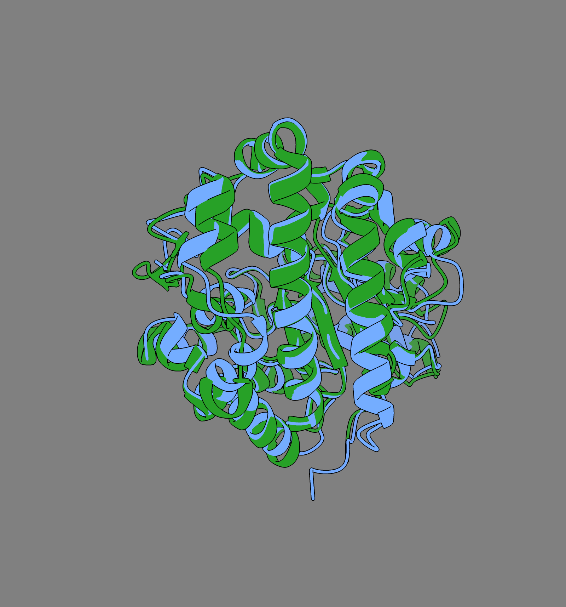

# Porphyria Cutanea Tarda Type 2 (PCT2)

### Authors: Sara Charif Karkri el Abbassi and Laia Núñez Palma

### _Bioinformatics, UPC, Barcelona, Spain_

## Abstract
**Background:** Porphyria cutanea tarda (PCT) type 2 (PCT2) is an autosomal dominant metabolic disorder caused by a 50% reduction in uroporphyrinogen decarboxylase (UROD) enzyme activity. In this study, we performed comparative bioinformatic, sequence alignment, and three-dimensional (3D) structural analyses to elucidate the molecular basis of a pathogenic _UROD_ variant.

**Results:** Pairwise alignments of human wild-type and disease-associated coding DNA sequences (CDS) and protein chains revealed a single nucleotide transition (c.779T>C) resulting in a missense substitution (p.Ile260Thr). Evolutionary conservation analysis across _Homo sapiens_, _Pan troglodytes_, and _Bacillus subtilis_ demonstrated detectable conservation along 95% of the protein (95% query coverage, E-value 1e-77, 38.70% identity), contrasting with a CDS alignment restricted to 12% of the sequence, reflecting purifying selection to maintain core catalytic functions. 3D structural superposition yielded a global root-mean-square deviation (RMSD) of 0.253 Å between wild-type and mutant human models, with a local backbone displacement of only 0.147 Å.

**Conclusions:** These findings suggest that the p.Ile260Thr variant does not change the overall shape of the enzyme; instead, replacing the non-polar isoleucine with a polar threonine close to the active site may change how the neighbouring amino acids interact, reducing UROD activity and hence heme biosynthesis.

## Keywords

Uroporphyrinogen decarboxylase (UROD), porphyria cutanea tarda type 2 (PCT2), Basic Local Alignment Search Tool (BLAST), missense mutation, sequence conservation, penetrance.

## Background

Porphyria cutanea tarda (PCT) type 2 (PCT2) is a rare metabolic disorder characterized by a 50% reduction in the activity of the enzyme uroporphyrinogen decarboxylase (UROD) (Soufleris et al. 2024).

The principal function of this enzyme is to assist in the production of heme, an essential component for creating hemoglobin (which gives blood its red colour and transports oxygen) and for enabling the liver to eliminate toxins (Online Mendelian Inheritance in Man n.d.). Specifically, the protein UROD, encoded by the gene also called UROD, catalyzes the sequential decarboxylation of the four acetate side chains of uroporphyrinogen III to yield coproporphyrinogen III, an indispensable step in the heme biosynthesis pathway. Because this step is required for fundamental cellular metabolism, the enzyme is present in both prokaryotic and eukaryotic organisms (Whitby et al. 1998).

This hereditary condition affects both men and women, as it is transmitted in an autosomal dominant pattern. This means that the gene responsible is located on a non-sex chromosome (autosome), and inheriting a single mutated copy of the _UROD_ gene from either parent is sufficient to predispose an individual to the disease (MSD Manuals n.d.b).

Each child of a carrier has a 50% chance of inheriting the altered gene, and most carriers inherit it from a parent who is completely asymptomatic. The reason why carriers produce only 50% of the fully functional UROD enzyme is that cells use both copies of the gene (one from the father and one from the mother) and since one copy is defective, only half of the normal amount is produced (Soufleris et al. 2024).

### Clinical symptoms

The manifestations of this disease are mainly cutaneous and result from the accumulation of porphyrins (organic molecules involved in heme biosynthesis that do not contain iron). Accumulated porphyrinogens are oxidized to porphyrins, which deposit in the skin and, when activated by sunlight, generate reactive oxygen species that damage the skin (MSD Manuals n.d.a).

The most common symptoms are: extreme skin fragility (the skin erodes or peels off with minimal friction); blisters and vesicles that leave erosions, crusts, and scars (appearing predominantly on sun-exposed areas such as the backs of the hands, forearms, and face); pigmentation changes (hyperpigmentation or hypopigmentation); dark reddish-brown urine and increased growth of fine hair, especially on the face (Orphanet n.d.).

### Penetrance

In hereditary PCT2, the UROD deficiency is present in all body tissues, including red blood cells (MSD Manuals n.d.b, Soufleris et al. 2024), unlike type 1 (sporadic/acquired), in which the deficiency is restricted to the liver. In principle, this might suggest that anyone with the mutation would manifest symptoms of the disease; however, PCT2 involves a genetic phenomenon known as incomplete penetrance, where carrying the mutation does not guarantee the development of the pathology (The Medical Biochemistry Page n.d.).

Most individuals with the mutation are asymptomatic (latent carriers), and only a minority develop the disease. This occurs because the inherited mutation reduces UROD activity by half; however, under normal conditions this residual activity is sufficient for heme synthesis (American Porphyria Foundation n.d., MSD Manuals n.d.b, Soufleris et al. 2024).

For the disease to manifest clinically (presenting with characteristic symptoms such as skin fragility and blistering upon exposure to sunlight), the patient's liver must be exposed to environmental factors that cause hepatic enzyme activity to drop by more than 75% (MSD Manuals n.d.b).

### Risk factors

Studies show that, in the majority of cases, individuals who develop PCT2 have been exposed to factors that place oxidative stress on the liver, such as iron overload, excessive alcohol or tobacco use, chronic viral infections (e.g. hepatitis C or human immunodeficiency virus, HIV), end-stage renal disease on hemodialysis, the use of estrogen-containing medications (contraceptives or hormone therapies), or exposure to industrial chemicals (Egger et al. 2002, International Porphyria Network n.d.).

### Diagnosis

PCT is diagnosed by measuring excess porphyrins in blood, urine (uroporphyrins), and stool (isocoproporphyrins) samples. Distinguishing type 1 from type 2 requires measuring erythrocyte UROD activity (reduced to ~50% in type 2, normal in type 1) and genetic testing of the _UROD_ gene (Mayo Clinic n.d., MSD Manuals n.d.b).

### Treatment

The aim of PCT treatment is to lower the amount of porphyrins in the body. This is done in two ways: by reducing their production with venesection (regular removal of blood to lower iron levels, which allows the UROD enzyme to work again), or by helping the body eliminate them with low doses of chloroquine or hydroxychloroquine (International Porphyria Network n.d.).

It is also essential to avoid the factors that trigger the disease: stop drinking alcohol and smoking, stop taking estrogens, avoid iron supplements, and treat underlying conditions such as hepatitis C. Patients must also protect their skin from sunlight with clothing and physical sunscreens (International Porphyria Network n.d.).

### Sequence analysis

Because PCT2 originates from mutations in the _UROD_ gene, analysing the mutated sequence can help explain how a single genetic change reduces the activity of the enzyme. Biological sequences can be compared to identify similarities and differences. Sequence comparison with the Basic Local Alignment Search Tool (BLAST) makes it possible to identify unknown DNA and protein sequences, to locate the variant that distinguishes a disease-associated sequence from the wild-type (WT) sequence, and to search for homologous sequences in other species. Conserved positions, which have remained similar during evolution, can indicate regions that are important for protein structure or function.

### Aims of the study

The aims of this study were therefore: to identify the gene and protein corresponding to the wild-type coding sequence (CDS) and protein sequences provided for the project; to confirm the identity of the mutant sequences and to characterize the variant at the nucleotide and amino-acid levels; to examine whether the variant lies in a region conserved across species; and to assess its effect on the three-dimensional (3D) structure of the enzyme, as a first step towards explaining its pathogenic effect.

## Results

### Identification and Genomic Context of the Gene and Protein

Four FASTA sequences were provided for the project: the WT CDS, the WT protein, the mutant CDS, and the mutant protein. The BLAST searches of the two WT sequences confirmed that they belong to the same gene. The WT CDS matched the curated human mRNA NM_000374.5 (_UROD_, _Homo sapiens_), and the WT protein matched the curated protein NP_000365.3 (uroporphyrinogen decarboxylase), which is the protein encoded by that mRNA. In both searches these records were the first hit, covering 100% of the query with 100% identity and an E-value of 0.0 (Table 1). Table 1 summarizes the coverage, identity, and E-value of every BLAST comparison made in this study.

The gene and its protein share the same symbol, UROD, as is usual in gene nomenclature. According to the National Center for Biotechnology Information (NCBI) Gene record, the gene is located on chromosome 1, at position 1p34.1 (reference sequence NC_000001.11), and has 10 exons. It is expressed in all 27 tissues examined, which is consistent with the enzyme defect of PCT2 being present in all cells, including liver cells (hepatocytes) and red blood cells. It is also expressed during development: fetal data show transcription in the six tissues examined (heart, kidney, lung, stomach, intestine, and adrenal gland).

| Query | Subject (accession, organism) | Program | Query coverage | Identities | Positives | Gaps | E-value |
|---|---|---|---|---|---|---|---|
| WT CDS (1104 nt) | NM_000374.5, _Homo sapiens_ UROD mRNA | BLASTn, core_nt | 100% | 100% (1104/1104) | – | 0/1104 | 0.0 |
| WT protein (367 amino acids) | NP_000365.3, _Homo sapiens_ UROD | BLASTp, nr | 100% | 100% (367/367) | 367/367 (100%) | 0/367 | 0.0 |
| Mutant CDS (1104 nt) | NM_000374.5, _Homo sapiens_ UROD mRNA | BLASTn, core_nt | 100% | 99.91% (1103/1104) | – | 0/1104 | 0.0 |
| Mutant protein (367 amino acids) | NP_000365.3, _Homo sapiens_ UROD | BLASTp, nr | 100% | 99.73% (366/367) | 366/367 (99%) | 0/367 | 0.0 |
| WT CDS | XM_513127.7, _Pan troglodytes_ UROD mRNA (CDS 594–1697) | BLASTn, core_nt search (excluding _Homo sapiens_) and two sequences | 100% | 99.64% (1100/1104) | – | 0/1104 | 0.0 |
| WT CDS | NZ_JAXKIH010000008.1:c180787-179726, _Bacillus subtilis_ hemE CDS | BLASTn, two sequences | 12% | 67.15% (92/137) | – | 3/137 | 1e-05 |
| WT protein | XP_513127.1, _Pan troglodytes_ UROD isoform X1 | BLASTp, nr search (_Pan troglodytes_) and two sequences | 100% | 99.73% (366/367) | 366/367 (99%) | 0/367 | 0.0 |
| WT protein | WP_327829039.1, _Bacillus subtilis_ uroporphyrinogen decarboxylase | BLASTp, two sequences | 95% | 38.70% (137/354) | 206/354 (58%) | 17/354 | 1e-77 |
**Table 1.** Summary of the BLAST comparisons performed in this study. Query coverage, identities, positives, gaps, and E-value are those reported by NCBI BLAST.

### Sequence Alignment and Mutation Characterization

The two mutant sequences, the mutant CDS and the mutant protein, were searched in the same way. The mutant CDS also matched NM_000374.5 as the best curated hit, covering 100% of the query with an E-value of 0.0 and 99.91% identity, so it comes from the same gene as the WT CDS. The two sequences differ at a single nucleotide: position 779 of the CDS. At that position the WT thymine (T) is replaced by a cytosine (C), written c.779T>C. Reading the CDS in codons, position 779 is the second base of codon 260 (c.778–c.780), which changes from ATC to ACC; ATC codes for isoleucine and ACC for threonine, so the change is a missense mutation.

The mutant protein also matched NP_000365.3, covering 100% of the query with an E-value of 0.0 and 99.73% identity, and its only difference from the WT protein is this isoleucine-to-threonine substitution at position 260, written p.Ile260Thr.

Finally, a direct alignment of the WT and mutant sequences confirmed that nothing was inserted or deleted: there are no gaps, the reading frame is preserved, and no frameshift occurs (Figure 1).

The variant at the CDS level is therefore a single nucleotide substitution, while at the protein level it results in a single amino-acid substitution, replacing a large, hydrophobic isoleucine with a smaller, polar threonine at position 260. A minor point mutation in the genetic code thus leads to a significant change in the physical and chemical properties of the protein chain. In practice, a non-polar residue such as isoleucine avoids water and packs against other non-polar residues, whereas a polar residue such as threonine can form hydrogen bonds; the consequences of this change are examined in the Discussion.

**Figure 1.** Pairwise BLAST alignments of WT (Query) and mutant sequences, query-anchored with dots for identities. (A) CDS positions 721–780: the WT thymine at position 779 is replaced by cytosine (c.779T>C). (B) Protein positions 241–300: isoleucine 260 is replaced by threonine (p.Ile260Thr).

### 3D Mutation Mapping and Local Conformational Impact
Structural evaluation of the disease-associated variant at position 260 reveals a missense substitution replacing the wild-type isoleucine with a threonine (p.Ile260Thr). Superposition of the human wild-type and mutant 3D structures demonstrates minimal backbone distortion, yielding a global RMSD of 0.253 Å and a local Cα backbone displacement of only 0.147 Å at position 260. At the corresponding aligned position in the bacterial ortholog (Bacillus subtilis), the residue is occupied by a methionine with a local backbone displacement of 1.329 Å.

**Figure 3.** Local 3D structural superposition centered at position 260 of human uroporphyrinogen decarboxylase (UROD). The ribbon backbone shows the wild-type model superimposed on the mutant model, highlighting the substituted side chains within the internal protein pocket (local Cα displacement = 0.147 Å). Image generated from the interactive course web interface provided by the Introduction to Bioinformatics course instructors (UPC, 2026).

**Figure 4.** Structural superposition between human UROD (blue) and Bacillus subtilis ortholog (green), showing high preservation of core alpha-helices and beta-sheets despite evolutionary divergence (global RMSD = 2.81 Å). Image generated from the interactive course web interface provided by the Introduction to Bioinformatics course instructors (UPC, 2026).

### Multi-Species Sequence Conservation Analysis

Analysis of sequence conservation across the three species demonstrates that conservation is not uniformly distributed. Homologous WT sequences were retrieved from _Bacillus subtilis_ (the assigned species) and _Pan troglodytes_ (the additional species) and aligned with the human sequences. Aligning human coding sequences against Pan troglodytes shows high sequence identity ranging between 96% and 99% with zero alignment gaps, consisting exclusively of single nucleotide substitutions. In contrast, alignment with Bacillus subtilis CDS is restricted to a small local fragment spanning only 12% query coverage with 67.15% identity and explicit structural gaps. Across protein sequences, high conservation is maintained between humans and chimpanzees over the full length of the chain with 99.73% identity and a single substitution at position 208. The protein alignment against Bacillus subtilis covers 95% of the sequence length with an E-value of 1e-77, 38.70% identity, and 17 gap positions resulting from insertions or deletions. Consequently, there are no highly conserved CDS regions shared across all three species simultaneously.

## Discussion
### Physicochemical and Structural Pathomechanism of p.Ile260Thr
Comparing the physicochemical properties of the wild-type and mutated residues explains the molecular mechanism of Porphyria Cutanea Tarda Type 2. Wild-type isoleucine is a large, non-polar, aliphatic residue buried within the internal hydrophobic core to stabilize tertiary folding through hydrophobic interactions. The p.Ile260Thr substitution introduces a smaller, polar threonine residue containing a hydrophilic hydroxyl (-OH) group into this buried non-polar environment. Because the local Cα backbone displacement is minimal (0.147 Å), the pathogenic mechanism is not driven by large structural distortion of the protein backbone. Instead, pathogenicity originates from local physicochemical disruption: the polar hydroxyl group disrupts internal hydrophobic packing and alters local hydrogen-bonding networks, destabilizing tertiary folding and impairing UROD catalytic activity below the threshold required for normal heme biosynthesis.

### Physicochemical and Functional Impact of the Variant

Evaluating side-chain properties reveals that while both isoleucine and threonine carry a net neutral charge at physiological pH, isoleucine possesses a larger four-carbon non-polar hydrocarbon side chain, whereas threonine contains a smaller two-carbon side chain with a polar hydroxyl group. Hydrophobic isoleucine residues are normally buried inside the internal core of the protein to stabilize its tertiary structure through hydrophobic interactions. Introducing a hydrophilic threonine residue introduces a polar hydroxyl group into this internal core, disrupting hydrophobic interactions and perturbing hydrogen-bonding networks. This structural disturbance forces the protein chain to refold incorrectly, destabilizing the enzyme and impairing catalytic activity, which directly contributes to the pathogenic mechanism of porphyria cutanea tarda.

### Evolutionary Divergence and Functional Constraints

Not all nucleotide variants lead to amino acid substitutions, as the degeneracy of the genetic code allows synonymous mutations to accumulate without altering the translated protein. Comparing multi-species conservation patterns across Homo sapiens, Pan troglodytes, and Bacillus subtilis demonstrates that evolutionary pressure acts unevenly across coding DNA sequences (CDS) and primary protein structures. Alignment against Pan troglodytes shows nearly complete sequence preservation across both CDS and protein levels, reflecting close common ancestry. Conversely, alignment between human and Bacillus subtilis CDS is restricted to a local fragment spanning only 12% query coverage with 67.15% identity, whereas protein-level alignment extends across 95% of the sequence length (E-value = 1e-77, 38.70% identity). This pronounced disparity between CDS and protein coverage illustrates the functional consequences of genetic code degeneracy and codon wobble flexibility. Redundant nucleotide transitions accumulate in coding sequences over evolutionary time without altering translated amino acid chains. Consequently, protein sequences are constrained by strict purifying selection to preserve core three-dimensional folding, active site geometry, and catalytic activity necessary for heme biosynthesis across vast taxonomic distances.

### Limitations

This study has three main limitations. First, conservation was examined in only three species, so a position that is identical in the three sequences is conserved in this alignment but may vary in other organisms; the functional residues discussed above are therefore supported mainly by the comparison of 13 UROD sequences, with 37 invariant residues, published by Whitby et al. (1998). Second, BLAST finds local similarities: the 12% coverage of the _Bacillus subtilis_ CDS alignment means that, at the DNA level, only a short fragment is similar enough to be detected between such distant species, not that the genes are unrelated, as the protein alignment shows. Third, the 3D analysis is based on a computational model of the mutant protein, and no experiment measured the stability or activity of the enzyme, so the proposed mechanism remains a hypothesis to be tested in the laboratory.

## Conclusions

This study proposes a molecular pathomechanism for porphyria cutanea tarda type 2 associated with the _UROD_ p.Ile260Thr variant. Bioinformatic analysis showed that the disease-associated sequence differs from the wild type by a single c.779T>C nucleotide transition. Cross-species comparative alignment demonstrated that while coding DNA sequences diverge significantly over evolutionary time, the UROD protein sequence is constrained by purifying selection to preserve heme biosynthesis, with its substrate-binding and hydrophobic core residues identical in the three species. 3D structural superposition indicated that the p.Ile260Thr mutation causes minimal global backbone distortion (RMSD = 0.253 Å). Instead, pathogenicity is likely to be driven by the introduction of a hydrophilic hydroxyl group into the buried non-polar core, which may disrupt local hydrophobic interactions, destabilize the enzyme, and impair its catalytic activity; combined with environmental triggers, this reduction could lower hepatic UROD activity below the threshold required for clinical manifestation.

## Methods

### Data sources

The CDS and protein sequences corresponding to the wild-type (WT) and mutant variants were initially provided in FASTA format. To carry out the research, a series of searches was performed in the NCBI nucleotide and protein databases. Among the highest-scoring results, curated NCBI Reference Sequence (RefSeq) entries (NM_ for mRNA and NP_ for protein accessions) were prioritized over predicted entries (XM_ and XP_); for _Pan troglodytes_, the search returned only predicted RefSeq records (XM_513127.7 and XP_513127.1), which were therefore used. The gene locus, chromosome, number of exons, and tissue expression were obtained from the NCBI Gene record linked to the selected RefSeq entries.

### Implementation

The WT and mutant CDS were searched with BLASTn, and the WT and mutant proteins with BLASTp, on the NCBI BLAST website, against the core_nt nucleotide database and the non-redundant protein database (nr), with the default settings (megablast for nucleotides; BLOSUM62 matrix for proteins). To find the homologs, the same searches were repeated with the human WT sequences. For the assigned species, BLASTn was run against the RefSeq Genome Database restricted to _Bacillus subtilis_ (taxid 1423) with the blastn algorithm for somewhat similar sequences (match/mismatch scores 1/−1, word size 7, gap costs 5/2, expect threshold 0.05), because the default settings detect no similarity between the human and bacterial CDS; the hits were the _hemE_ gene in _Bacillus subtilis_ genomes, and the RefSeq accession NZ_JAXKIH010000008.1 was selected. For the additional species, BLASTn was run against the core_nt database excluding _Homo sapiens_, and _Pan troglodytes_ was chosen among the best hits.

The sequences of the homologs were downloaded in FASTA format from NCBI: for _Bacillus subtilis_, the _hemE_ CDS from the nucleotide record NZ_JAXKIH010000008.1 (complement of positions 179726–180787, 1062 nt) and its protein WP_327829039.1 (353 amino acids) from the protein record; for _Pan troglodytes_, the mRNA XM_513127.7, whose CDS occupies positions 594–1697, from the nucleotide record, and the proteins of the gene from its NCBI Gene record with NCBI Datasets, a file that contains five predicted entries corresponding to four isoforms (X1 to X4), of which the full-length isoform X1 (XP_513127.1, 367 amino acids) was used. The WT and mutant sequences, and the human sequence against each homolog, were compared with the BLAST option 'Align two or more sequences', and the alignments were read in the 'Query-anchored with dots for identities' view, in which a dot marks a position identical to the query sequence. For each comparison, query coverage, identities, positives, gaps, and E-value were noted (Table 1). The variant was named with the c. (CDS) and p. (protein) notation, and the amino-acid change was checked by reading the affected codon in frame and translating it with the standard genetic code.

### 3D Structural Modelling and Superposition

Three-dimensional structural superpositions, root-mean-square deviation (RMSD) calculations, and local Cα backbone displacements were evaluated using the interactive web-based structural visualization module provided by the course instructors for the Introduction to Bioinformatics course (Universitat Politècnica de Catalunya, 2026). The module superposes the human WT structure on a model of the p.Ile260Thr mutant and on the structure of the _Bacillus subtilis_ ortholog, reports the global RMSD, the per-residue Cα displacement, and the secondary structure of each aligned position, and displays the WT and mutant side chains at the variant position.

### Statistical Analysis

Each hit was evaluated by combining query coverage (percentage of the query included in the alignment), percent identity (percentage of identical aligned positions), and E-value (number of matches of similar quality expected by chance in a database of that size), together with the sequence description, organism, and accession type. Additionally, side-chain physicochemical properties (size, charge, polarity, and hydrophobicity) were evaluated to predict the effect of the amino-acid substitution on UROD structure and activity, and thus its potential role in the pathogenesis of porphyria cutanea tarda type 2 (PCT2).

## Abbreviations

3D: three-dimensional; BLAST: Basic Local Alignment Search Tool; CDS: coding DNA sequence; HIV: human immunodeficiency virus; NCBI: National Center for Biotechnology Information; nt: nucleotides; PCT: porphyria cutanea tarda; PCT2: PCT type 2; RefSeq: NCBI Reference Sequence; RMSD: root-mean-square deviation; UROD: uroporphyrinogen decarboxylase; WT: wild type.

## Declarations
### Ethics approval and consent to participate
Not applicable. This study utilizes publicly available, anonymized bioinformatic and genomic database sequences.

### Consent for publication
Not applicable.

### Availability of data and materials
All sequence files (the FASTA files of the WT and mutant CDS and proteins and of the _Pan troglodytes_ and _Bacillus subtilis_ homologs), figures, screenshots of the BLAST searches used to identify the homologs (figures/evidence/), and cited references are available in the public GitHub repository: https://github.com/sara-charif-karkri/12DP-E_PCT_IB_2026.git

### Competing interests
The authors declare that they have no competing interests.

### Funding
This work was supported by the Undergraduate Bioinformatics Project curriculum at Universitat Politècnica de Catalunya (UPC).

### Authors' contributions
- **Laia Núñez Palma** (disease and literature specialist, sequence analyst, responsible for the biological foundation of the project): Conducted disease background research, clinical characterization, penetrance, and risk factor analyses. Performed pairwise CDS/protein alignments, multi-species conservation analyses, and mutation mapping.
- **Sara Charif Karkri el Abbassi** (project manager, data and database specialist, structural analyst): Retrieved and validated FASTA datasets, curated NCBI RefSeq entries, selected species orthologs, and gathered PDB structures. Performed local physicochemical cavity analysis. Managed project timeline, Gantt tracking, GitHub repository administration, and final report compilation.

All authors read and approved the final manuscript.

### Acknowledgements
We thank the course instructors of Introduction to Bioinformatics (UPC) for providing the initial FASTA sequence datasets and the interactive HTML structural visualization interface used for the 3D conformational analysis and technical guidance.

## References
- American Porphyria Foundation. Porphyria Cutanea Tarda (PCT). https://porphyriafoundation.org/for-patients/types-of-porphyria/pct/ (12 October 2026, date last accessed).
- Egger NG et al. Porphyria cutanea tarda: multiplicity of risk factors including HFE mutations, hepatitis C, and inherited uroporphyrinogen decarboxylase deficiency. Dig Dis Sci 2002;47:419–26.
- International Porphyria Network. Porphyria Cutanea Tarda (PCT). https://ipnet.org/porphyria-cutanea-tarda-pct-2/ (12 October 2026, date last accessed).
- Mayo Clinic. Porphyria: Diagnosis & treatment. https://www.mayoclinic.org/diseases-conditions/porphyria/diagnosis-treatment/drc-20356072 (12 October 2026, date last accessed).
- MSD Manuals. Overview of Cutaneous Porphyrias. https://www.msdmanuals.com/professional/hematology/the-porphyrias/overview-of-cutaneous-porphyrias (12 October 2026, date last accessed).
- MSD Manuals. Porphyria Cutanea Tarda. https://www.msdmanuals.com/professional/hematology/the-porphyrias/porphyria-cutanea-tarda (12 October 2026, date last accessed).
- National Center for Biotechnology Information. UROD uroporphyrinogen decarboxylase [Homo sapiens (human)]. https://www.ncbi.nlm.nih.gov/gene/7389 (9 October 2026, date last accessed).
- Online Mendelian Inheritance in Man. Porphyria cutanea tarda; PCT. https://www.omim.org/entry/176100 (11 October 2026, date last accessed).
- Orphanet. Porphyria cutanea tarda. https://www.orpha.net/en/disease/detail/101330 (12 October 2026, date last accessed).
- Soufleris S et al. Novel UROD mutation for porphyria cutanea tarda, type 2: a case report. AME Case Rep 2024;8:67.
- The Medical Biochemistry Page. Porphyria Cutanea Tarda, PCT. https://themedicalbiochemistrypage.org/porphyria-cutanea-tarda-pct/ (12 October 2026, date last accessed).
- Whitby FG et al. Crystal structure of human uroporphyrinogen decarboxylase. EMBO J 1998;17:2463–71.
