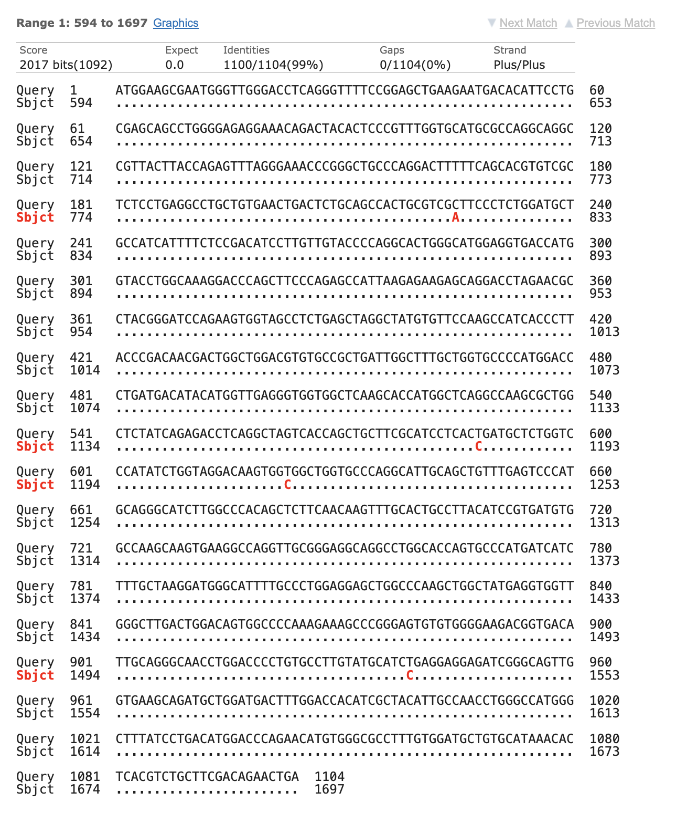
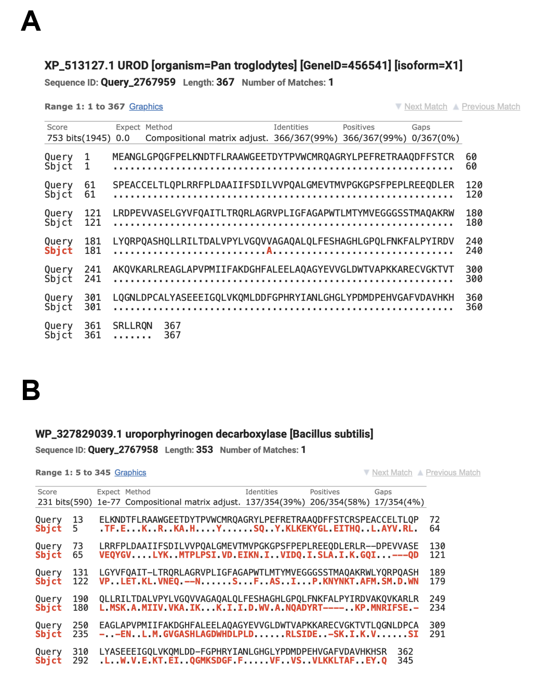
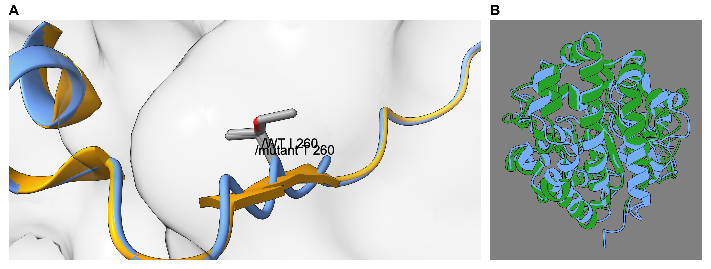

# Porphyria Cutanea Tarda Type 2 (PCT2)

### Authors: Sara Charif Karkri el Abbassi and Laia Núñez Palma

### _Bioinformatics, UPC, Barcelona, Spain_

## Abstract
**Background:** Porphyria cutanea tarda (PCT) type 2 (PCT2) is an autosomal dominant metabolic disorder characterized by a 50% reduction in uroporphyrinogen decarboxylase (UROD) enzyme activity. In this study, we performed comparative bioinformatic and sequence alignment analyses, and interpreted a three-dimensional (3D) structural comparison provided by the course, to elucidate the molecular basis of a pathogenic _UROD_ variant.

**Results:** Pairwise alignments of human wild-type and disease-associated coding DNA sequences (CDS) and protein chains revealed a single nucleotide transition (c.779T>C) resulting in a missense substitution (p.Ile260Thr). Evolutionary conservation analysis across _Homo sapiens_, _Pan troglodytes_, and _Bacillus subtilis_ demonstrated detectable conservation along 95% of the protein (95% query coverage, E-value 1e-77, 38.70% identity), contrasting with a CDS alignment restricted to 12% of the sequence, reflecting purifying selection to maintain core catalytic functions. The 3D structural comparison provided by the course showed a global root-mean-square deviation (RMSD) of 0.253 Å between the wild-type and mutant human structures, with a local backbone displacement of only 0.147 Å.

**Conclusions:** These findings suggest that the p.Ile260Thr variant does not change the overall shape of the enzyme; instead, replacing the non-polar isoleucine with a polar threonine close to the active site may change how the neighbouring amino acids interact, reducing UROD activity and hence heme biosynthesis.

## Keywords

Uroporphyrinogen decarboxylase (UROD), porphyria cutanea tarda type 2 (PCT2), Basic Local Alignment Search Tool (BLAST), missense mutation, sequence conservation.

## Background

Porphyria cutanea tarda (PCT) type 2 (PCT2) is a rare metabolic disorder characterized by a 50% reduction in the activity of the enzyme uroporphyrinogen decarboxylase (UROD) (Soufleris et al. 2024).

The principal function of this enzyme is to assist in the production of heme (National Center for Biotechnology Information n.d., Whitby et al. 1998), an essential component of hemoglobin, the protein that gives blood its red colour and transports oxygen. Specifically, the protein UROD, encoded by the gene also called _UROD_, catalyses the sequential decarboxylation of the four acetate side chains of uroporphyrinogen III to yield coproporphyrinogen III, an indispensable step in the heme biosynthesis pathway. Because this step is required for fundamental cellular metabolism, the enzyme is present in both prokaryotic and eukaryotic organisms (Whitby et al. 1998).

This hereditary condition affects both men and women, as it is transmitted in an autosomal dominant pattern. This means that the gene responsible is located on a non-sex chromosome (autosome), and inheriting a single mutated copy of the _UROD_ gene from either parent is sufficient to predispose an individual to the disease (MSD Manuals n.d.b, Online Mendelian Inheritance in Man n.d.).

Each child of a carrier has a 50% chance of inheriting the altered gene, and most carriers inherit it from a parent who is completely asymptomatic. The reason why carriers produce only 50% of the fully functional UROD enzyme is that cells use both copies of the gene (one from the father and one from the mother) and since one copy is defective, only half of the normal amount is produced (American Porphyria Foundation n.d., Soufleris et al. 2024).

### Clinical symptoms

The manifestations of this disease are mainly cutaneous and result from the accumulation of porphyrins (organic molecules involved in heme biosynthesis that do not contain iron). Accumulated porphyrinogens are oxidized to porphyrins, which deposit in the skin and, when activated by sunlight, generate reactive oxygen species that damage the skin (International Porphyria Network n.d., MSD Manuals n.d.a).

The most common symptoms are: extreme skin fragility (the skin erodes or peels off with minimal friction); blisters and vesicles that leave erosions, crusts, and scars (appearing predominantly on sun-exposed areas such as the backs of the hands, forearms, and face); pigmentation changes (hyperpigmentation or hypopigmentation); dark urine; and increased growth of fine hair, especially on the face (American Porphyria Foundation n.d., International Porphyria Network n.d., Orphanet n.d.).

### Penetrance

In hereditary PCT2, the UROD deficiency is present in all body tissues, including red blood cells (MSD Manuals n.d.b, Soufleris et al. 2024), unlike type 1 (sporadic/acquired), in which the deficiency is restricted to the liver. In principle, this might suggest that anyone with the mutation would manifest symptoms of the disease; however, PCT2 involves a genetic phenomenon known as incomplete penetrance, where carrying the mutation does not guarantee the development of the pathology (The Medical Biochemistry Page n.d.).

Most individuals with the mutation are asymptomatic (latent carriers), and only a minority develop the disease. This occurs because the inherited mutation reduces UROD activity by half; however, under normal conditions this residual activity is sufficient for heme synthesis (American Porphyria Foundation n.d., MSD Manuals n.d.b, Soufleris et al. 2024).

For the disease to manifest clinically (presenting with characteristic symptoms such as skin fragility and blistering upon exposure to sunlight), the patient's liver must be exposed to environmental factors that cause hepatic enzyme activity to drop to approximately 20–25% of normal (American Porphyria Foundation n.d., MSD Manuals n.d.b).

### Risk factors

Studies show that, in the majority of cases, individuals who develop PCT2 have been exposed to factors that place oxidative stress on the liver, such as iron overload, excessive alcohol or tobacco use, chronic viral infections (e.g. hepatitis C or human immunodeficiency virus, HIV), end-stage renal disease on hemodialysis, the use of estrogen-containing medications (contraceptives or hormone therapies), or exposure to industrial chemicals (International Porphyria Network n.d., Egger et al. 2002).

### Diagnosis

PCT is diagnosed by measuring excess porphyrins in blood, urine (uroporphyrins), and stool (isocoproporphyrins) samples. Distinguishing type 1 from type 2 requires measuring erythrocyte UROD activity (reduced to ~50% in type 2, normal in type 1) or genetic testing of the _UROD_ gene (Mayo Clinic n.d., MSD Manuals n.d.b).

### Treatment

The aim of PCT treatment is to lower the amount of porphyrins in the body. This is done in two ways: by reducing their production with venesection (regular removal of blood to lower iron levels, which allows the UROD enzyme to work again), or by helping the body eliminate them with low doses of chloroquine or hydroxychloroquine (International Porphyria Network n.d.).

It is also essential to avoid the factors that trigger the disease: stop drinking alcohol and smoking, stop taking estrogens, avoid iron supplements, and treat underlying conditions such as hepatitis C. Patients must also protect their skin from sunlight with clothing and physical sunscreens (International Porphyria Network n.d.).

### Sequence analysis

Because PCT2 originates from mutations in the _UROD_ gene, analysing the mutated sequence can help explain how a single genetic change reduces the activity of the enzyme. Biological sequences can be compared to identify similarities and differences. Sequence comparison with the Basic Local Alignment Search Tool (BLAST) makes it possible to identify unknown DNA and protein sequences, to locate the variant that distinguishes a disease-associated sequence from the wild-type (WT) sequence, and to search for homologous sequences in other species. Conserved positions, which have remained similar during evolution, can indicate regions that are important for protein structure or function.

### Aims of the study

The aims of this study were therefore: to identify the gene and protein corresponding to the wild-type coding DNA sequence (CDS) and protein sequences provided for the project; to confirm the identity of the mutant sequences and to characterize the variant at the nucleotide and amino-acid levels; to examine whether the variant lies in a region conserved across species; and to examine its effect on the three-dimensional (3D) structure of the enzyme using the structural comparison provided by the course, as a first step towards explaining its pathogenic effect.

## Results

### Identification and Genomic Context of the Gene and Protein

Four FASTA sequences were provided for the project: the WT CDS, the WT protein, the mutant CDS, and the mutant protein. The BLAST searches of the two WT sequences confirmed that they belong to the same gene. The WT CDS matched the curated human mRNA NM_000374.5 (_UROD_, _Homo sapiens_), and the WT protein matched the curated protein NP_000365.3 (uroporphyrinogen decarboxylase), which is the protein encoded by that mRNA. In both searches these records were the first hit, covering 100% of the query with 100% identity and an E-value of 0.0 (Table 1). Table 1 summarizes the coverage, identity, and E-value of every BLAST comparison made in this study.

The gene and its protein share the same symbol, UROD, as is usual in gene nomenclature. According to the National Center for Biotechnology Information (NCBI) Gene record, the gene is located on chromosome 1, at position 1p34.1 (reference sequence NC_000001.11), and has 10 exons. It is expressed in all 27 tissues examined, which is consistent with the enzyme defect of PCT2 being present in all cells, including liver cells (hepatocytes) and red blood cells. It is also expressed during development: fetal data show transcription in the six tissues examined (heart, kidney, lung, stomach, intestine, and adrenal gland).

**Table 1.** Summary of the BLAST comparisons performed in this study. Query coverage, identities, positives, gaps, and E-value are those reported by NCBI BLAST.

| Query | Subject (accession, organism) | Program | Query coverage | Identities | Positives | Gaps | E-value |
|---|---|---|---|---|---|---|---|
| WT CDS (1104 nt) | NM_000374.5, _Homo sapiens_ _UROD_ mRNA | BLASTn, core_nt | 100% | 100% (1104/1104) | – | 0/1104 | 0.0 |
| WT protein (367 amino acids) | NP_000365.3, _Homo sapiens_ UROD | BLASTp, nr | 100% | 100% (367/367) | 367/367 (100%) | 0/367 | 0.0 |
| Mutant CDS (1104 nt) | NM_000374.5, _Homo sapiens_ _UROD_ mRNA | BLASTn, core_nt | 100% | 99.91% (1103/1104) | – | 0/1104 | 0.0 |
| Mutant protein (367 amino acids) | NP_000365.3, _Homo sapiens_ UROD | BLASTp, nr | 100% | 99.73% (366/367) | 366/367 (99%) | 0/367 | 0.0 |
| WT CDS | XM_513127.7, _Pan troglodytes_ _UROD_ mRNA (CDS 594–1697) | BLASTn, core_nt search (excluding _Homo sapiens_) and two sequences | 100% | 99.64% (1100/1104) | – | 0/1104 | 0.0 |
| WT CDS | NZ_JAXKIH010000008.1:c180787-179726, _Bacillus subtilis_ _hemE_ CDS | BLASTn, two sequences | 12% | 67.15% (92/137) | – | 3/137 | 1e-05 |
| WT protein | XP_513127.1, _Pan troglodytes_ UROD isoform X1 | BLASTp, nr search (_Pan troglodytes_) and two sequences | 100% | 99.73% (366/367) | 366/367 (99%) | 0/367 | 0.0 |
| WT protein | WP_327829039.1, _Bacillus subtilis_ uroporphyrinogen decarboxylase | BLASTp, two sequences | 95% | 38.70% (137/354) | 206/354 (58%) | 17/354 | 1e-77 |

### Sequence Alignment and Mutation Characterization

The two mutant sequences, the mutant CDS and the mutant protein, were searched in the same way. The mutant CDS also matched NM_000374.5 as the best curated hit, covering 100% of the query with an E-value of 0.0 and 99.91% identity, so it comes from the same gene as the WT CDS. The two sequences differ at a single nucleotide: position 779 of the CDS. At that position the WT thymine (T) is replaced by a cytosine (C), written c.779T>C. Reading the CDS in codons, position 779 is the second base of codon 260 (c.778–c.780), which changes from ATC to ACC; ATC codes for isoleucine and ACC for threonine, so the change is a missense mutation.

The mutant protein also matched NP_000365.3, covering 100% of the query with an E-value of 0.0 and 99.73% identity, and its only difference from the WT protein is this isoleucine-to-threonine substitution at position 260, written p.Ile260Thr.

Finally, a direct alignment of the WT and mutant sequences confirmed that nothing was inserted or deleted: there are no gaps, the reading frame is preserved, and no frameshift occurs (Figure 1).

The variant at the CDS level is therefore a single nucleotide substitution, while at the protein level it results in a single amino-acid substitution, replacing a large, hydrophobic isoleucine with a smaller, polar threonine at position 260. A minor point mutation in the genetic code thus leads to a significant change in the physical and chemical properties of the protein chain. The consequences of this change are examined in the Discussion.

**Figure 1.** Pairwise BLAST alignments of WT (Query) and mutant sequences, query-anchored with dots for identities. (A) CDS positions 721–780: the WT thymine at position 779 is replaced by cytosine (c.779T>C). (B) Protein positions 241–300: isoleucine 260 is replaced by threonine (p.Ile260Thr).

### Multi-Species Sequence Conservation Analysis

The human WT sequences were then compared with their homologs in two other species. For the assigned species, _Bacillus subtilis_ (strain CB00742), the homologous gene is _hemE_: its CDS is the region NZ_JAXKIH010000008.1:c180787-179726 and its protein is WP_327829039.1 (353 amino acids).

For the additional species, _Pan troglodytes_, the homologous gene is also called _UROD_. Its mRNA is the predicted record XM_513127.7 (transcript variant X1), in which the CDS occupies positions 594–1697. Its protein is the predicted record XP_513127.1 (isoform X1, 367 amino acids); this was the only full-length isoform among the five protein entries retrieved for the gene, which cover isoforms X1 to X4. Table 1 summarizes the results of these alignments, which show that conservation is not distributed equally along the sequences.

Aligning the human CDS against the _Pan troglodytes_ CDS gives 99.64% identity (1100 of 1104 positions) with no gaps. The two sequences differ at only four nucleotides, written here as human base > chimpanzee base: c.225C>A, c.588T>C, c.623T>C, and c.939T>C (Figure 2). Only one of them changes the protein: c.623T>C is at the second position of codon 208 and replaces valine with alanine (Val208Ala). The other three are at the third position of their codons and are synonymous, so the amino acid does not change.

**Figure 2.** BLASTn alignment of the human WT _UROD_ CDS (Query, 1104 nt) against the _Pan troglodytes_ _UROD_ mRNA XM_513127.7 (Sbjct positions 594–1697), query-anchored with dots for identities: 1100/1104 identities, 0 gaps, E-value 0.0. The four substitutions (c.225C>A, c.588T>C, c.623T>C, and c.939T>C) are shown in red.

The comparison with _Bacillus subtilis_ at the CDS level gives a very different picture: BLASTn finds similarity only in a short fragment, positions c.898 to c.1031, which covers 12% of the human CDS, with 67.15% identity (92 of 137 aligned positions) and three gaps.

The protein alignments were then examined for both species. Human and chimpanzee proteins are 99.73% identical along their whole length, with the single difference Val208Ala. Human and _Bacillus subtilis_ proteins, unlike their CDS, align along 95% of the human sequence with an E-value of 1e-77: 38.70% of the aligned positions are identical and 17 positions are gaps caused by insertions or deletions.

At the DNA level, the human and bacterial CDS share only one stretch; the rest of the gene has changed so much that BLAST no longer detects any similarity.

At the protein level, the alignment shows several short stretches that are exactly the same in human, chimpanzee, and _Bacillus subtilis_ (residues 31–34, 36–41, 79–82, 149–154, 279–284, 302–307, and 336–340), while all the differences with the bacterium, the changed amino acids and the 17 gaps, lie outside them (Figure 3).

To find out whether these conserved stretches have a known function, we checked the paper describing the crystal structure of human UROD (Whitby et al. 1998). According to that paper, six amino acids are the same in almost every UROD sequence its authors compared, and all six sit in the active site, the pocket where the enzyme binds its substrate. Three of them, Arg37, Arg41, and His339, probably hold the substrate; the other three, Asp86, Tyr164, and Ser219, may help to hold it or to carry out the reaction. All six are also identical in our three species, and the only conserved fragment of the CDS is the one that contains the codon for His339. Position 260, where the disease-associated variant is, has isoleucine in human and chimpanzee and methionine in the bacterium; these are different amino acids, but both avoid water (both are hydrophobic). Its neighbours Val256, Pro257, Ile259, and Phe261 are identical in the three species, and Lys263 is different in the bacterium (Figure 3). The same paper places Phe261 and Lys263 in the wall of the active site. So the variant is not inside the active site, but right next to it.

**Figure 3.** BLASTp alignments of the human WT UROD protein (Query) against (A) _Pan troglodytes_ UROD isoform X1 (XP_513127.1; 366/367 identities, 0 gaps; the single substitution Val208Ala is highlighted) and (B) _Bacillus subtilis_ uroporphyrinogen decarboxylase (WP_327829039.1; 137/354 identities, 206/354 positives, 17/354 gaps). Dots indicate identities; differing residues are shown in red.

### 3D Mutation Mapping and Local Conformational Impact

The structural comparison provided by the course instructors (see Methods) superposes the human wild-type and mutant 3D structures for the disease-associated variant at position 260 (p.Ile260Thr). The superposition shows minimal backbone distortion, yielding a global root-mean-square deviation (RMSD) of 0.253 Å and a local Cα backbone displacement of only 0.147 Å at position 260 (Figure 4A). At the corresponding aligned position in the bacterial ortholog (_Bacillus subtilis_), the residue is a methionine, with a local backbone displacement of 1.329 Å between the human and bacterial structures. Overall, the human and _Bacillus subtilis_ structures superpose with a global RMSD of 2.81 Å despite only 39.0% identical residues (59.0% of the same physicochemical class) over the structurally aligned positions (Figure 4B).

**Figure 4.** 3D structural comparison provided by the course instructors. (A) Local view centred at position 260 of human UROD: the WT structure superimposed on the Ile260Thr mutant, with the substituted side chain shown as sticks (local Cα displacement = 0.147 Å). (B) Global superposition of the human (blue) and _Bacillus subtilis_ (green) structures (RMSD = 2.81 Å).

## Discussion

### How the p.Ile260Thr change may affect the enzyme

The variant replaces one amino acid by another at position 260, and the two differ in one key property. Isoleucine is non-polar: it has no affinity for water, so it tends to sit away from water, packed against other non-polar amino acids. Threonine is polar: its side chain carries a hydroxyl (-OH) group that attracts water and can form hydrogen bonds with water or with other polar groups. Both are neutral, without electric charge, and threonine is somewhat smaller. In short, the mutation puts a water-attracting group where the protein normally has a water-avoiding one.

Where this happens matters. Our results show that position 260 is hydrophobic in the three species and that four of its neighbours are identical in all of them, so this stretch has been kept through evolution. Two of its neighbours, Phe261 and Lys263, are part of the wall of the active site according to the crystal structure of human UROD (Whitby et al. 1998). The change therefore occurs right next to the place where the enzyme binds its substrate.

The 3D superposition tells us what the change does not do: the backbone of the protein barely moves. The global RMSD between the WT and mutant structures is 0.253 Å, and the local displacement at position 260 is 0.147 Å, both tiny compared with the size of an amino acid. As the course material points out, a small movement of the backbone does not rule out an effect: the consequence can be chemical rather than structural, because the side chain that interacts with its surroundings is now a different one.

Putting the three observations together, the most likely explanation is that the mutant enzyme keeps its overall shape but loses some of the contacts that isoleucine made with its non-polar neighbours and gains a polar group next to the active site. Either of these could make the enzyme work less well. We cannot measure this effect with the tools used here, so it remains a hypothesis. What is known from the clinical side is consistent with it: carriers of a PCT2 mutation have about half of the normal UROD activity, and the disease appears only when additional factors lower the activity of the liver enzyme further (MSD Manuals n.d.b).

### Evolutionary Divergence and Functional Constraints

A change in the DNA does not always change the protein. Each amino acid is coded by a group of three nucleotides, a codon, and most amino acids have several codons; when a change produces a codon for the same amino acid, the protein stays the same (a synonymous change). Our data show this clearly: the human and chimpanzee CDS differ at four nucleotides, but their proteins differ at a single amino acid (Val208Ala), because the other three changes (c.225C>A, c.588T>C, and c.939T>C) are at the third position of their codons and are synonymous.

The comparison with _Bacillus subtilis_ shows a second effect. Only 39% of the aligned amino acids are identical, but 58% are identical or similar, so many of the changes replace an amino acid by another with similar properties, for example one hydrophobic amino acid by another. BLASTp gives these similar pairs a positive score through its scoring matrix (BLOSUM62), which is why they count as positives.

Together these two effects explain why the three species look more similar at the protein level than at the DNA level. Changes that damage the protein tend to be eliminated over the generations, because the organisms that carry them work worse; this is called purifying selection. Changes that do not alter the protein, or that replace an amino acid by a similar one, are not eliminated and accumulate in the DNA.

This also explains which positions never change: the ones where a change would stop the enzyme from working. A position can be essential for two reasons: because that amino acid takes part in the reaction, or because it helps to keep the protein folded in the right shape. The six amino acids of the active site named in the crystal structure, Arg37, Arg41, His339, Asp86, Tyr164, and Ser219 (Whitby et al. 1998), are exactly the same in human, chimpanzee, and bacterium. Position 260, where the variant is, is a different case: the amino acid is not the same in the three species (isoleucine in human and chimpanzee, methionine in the bacterium), but in all three it is hydrophobic, it avoids water. This suggests that what evolution has kept at that position is not a specific amino acid but a property, being hydrophobic.

### Limitations

This study has three main limitations. First, conservation was examined in only three species, so a position that is identical in the three sequences is conserved in this alignment but may vary in other organisms; the functional residues discussed above are therefore supported mainly by the comparison of 13 UROD sequences, with 37 invariant residues, published by Whitby et al. (1998). Second, BLAST finds local similarities: the 12% coverage of the _Bacillus subtilis_ CDS alignment means that, at the DNA level, only a short fragment is similar enough to be detected between such distant species, not that the genes are unrelated, as the protein alignment shows. Third, the 3D analysis is based on a structural comparison provided by the course, whose source structures and method were not disclosed to us, and no experiment measured the stability or activity of the enzyme, so the proposed mechanism remains a hypothesis to be tested in the laboratory.

## Conclusions

This study proposes a molecular pathomechanism for PCT2 associated with the _UROD_ p.Ile260Thr variant. Bioinformatic analysis showed that the disease-associated sequence differs from the wild type by a single c.779T>C nucleotide transition. Cross-species comparative alignment demonstrated that while coding DNA sequences diverge significantly over evolutionary time, the UROD protein sequence is constrained by purifying selection to preserve heme biosynthesis, with its substrate-binding residues identical in the three species. The 3D structural comparison indicated that the p.Ile260Thr mutation causes minimal global backbone distortion (RMSD = 0.253 Å). Instead, pathogenicity is likely to be driven by the introduction of a hydrophilic hydroxyl group into a non-polar environment adjacent to the active-site cleft, which may disrupt local hydrophobic interactions, destabilize the enzyme, and impair its catalytic activity; combined with environmental triggers, this reduction could lower hepatic UROD activity below the threshold required for clinical manifestation.

## Methods

### Data sources

The CDS and protein sequences corresponding to the wild-type (WT) and mutant variants were initially provided in FASTA format. To carry out the research, a series of searches was performed in the NCBI nucleotide and protein databases. Among the highest-scoring results, curated NCBI Reference Sequence (RefSeq) entries (NM_ for mRNA and NP_ for protein accessions) were prioritized over predicted entries (XM_ and XP_); for _Pan troglodytes_, the search returned only predicted RefSeq records (XM_513127.7 and XP_513127.1), which were therefore used. The gene locus, chromosome, number of exons, and tissue expression were obtained from the NCBI Gene record linked to the selected RefSeq entries.

### Implementation

The WT and mutant CDS were searched with BLASTn, and the WT and mutant proteins with BLASTp, on the NCBI BLAST website, against the core_nt nucleotide database and the non-redundant protein database (nr), with the default settings (megablast for nucleotides; BLOSUM62 matrix for proteins). To find the homologs, the same searches were repeated with the human WT sequences, restricting BLASTp to each species. For the assigned species, BLASTn was run against the RefSeq Genome Database restricted to _Bacillus subtilis_ (taxid 1423) with the blastn algorithm for somewhat similar sequences (match/mismatch scores 1/−1, word size 7, gap costs 5/2, expect threshold 0.05), because the default settings detect no similarity between the human and bacterial CDS; the hits were the _hemE_ gene in _Bacillus subtilis_ genomes, and the RefSeq accession NZ_JAXKIH010000008.1 (strain CB00742) was selected. For the additional species, BLASTn was run against the core_nt database excluding _Homo sapiens_, and _Pan troglodytes_ was chosen among the best hits.

The sequences of the homologs were downloaded in FASTA format from NCBI: for _Bacillus subtilis_, the _hemE_ CDS from the nucleotide record NZ_JAXKIH010000008.1 (complement of positions 179726–180787, 1062 nt) and its protein WP_327829039.1 (353 amino acids) from the protein record; for _Pan troglodytes_, the mRNA XM_513127.7, whose CDS occupies positions 594–1697, from the nucleotide record, and the proteins of the gene from its NCBI Gene record with NCBI Datasets, a file that contains five predicted entries corresponding to four isoforms (X1 to X4), of which the full-length isoform X1 (XP_513127.1, 367 amino acids) was used.

Once the sequences had been identified, they were compared with the BLAST option 'Align two or more sequences', which does not search any database but simply aligns the sequences that are pasted in; this makes it the right tool to compare two known sequences position by position. In this way the WT and mutant sequences, and the human sequence against each homolog, were aligned, and the alignments were read in the 'Query-anchored with dots for identities' view, in which a dot marks a position identical to the query sequence. For each comparison, query coverage, identities, positives, gaps, and E-value were noted (Table 1). The variant was named with the c. (CDS) and p. (protein) notation, and the amino-acid change was checked by reading the affected codon in frame and translating it with the standard genetic code.

### 3D Structural Comparison

The 3D structural comparison was not generated by the authors. The course instructors of Introduction to Bioinformatics (Universitat Politècnica de Catalunya, 2026) provided an interactive report (HTML, also exported as PDF) that superposes the human WT structure on the Ile260Thr mutant and on the _Bacillus subtilis_ ortholog, and reports the global RMSD, the Cα backbone displacement of each aligned residue, the secondary structure of each aligned position, and a view of the WT and mutant side chains at the variant position. The values and the image used in this report (Figure 4) were taken from that document; the structures and the superposition method used to build it were not disclosed to the authors.

### Statistical Analysis

Each hit was evaluated by combining query coverage (percentage of the query included in the alignment), percent identity (percentage of identical aligned positions), and E-value (number of matches of similar quality expected by chance in a database of that size), together with the sequence description, organism, and accession type. Additionally, side-chain physicochemical properties (size, charge, polarity, and hydrophobicity) were evaluated to predict the effect of the amino-acid substitution on UROD structure and activity, and thus its potential role in the pathogenesis of PCT2.

## Abbreviations

3D: three-dimensional; BLAST: Basic Local Alignment Search Tool; CDS: coding DNA sequence; HIV: human immunodeficiency virus; NCBI: National Center for Biotechnology Information; nt: nucleotides; PCT: porphyria cutanea tarda; PCT2: PCT type 2; RefSeq: NCBI Reference Sequence; RMSD: root-mean-square deviation; UROD: uroporphyrinogen decarboxylase; WT: wild type.

## Declarations
### Ethics approval and consent to participate
Not applicable. This study utilizes publicly available, anonymized bioinformatic and genomic database sequences.

### Consent for publication
Not applicable.

### Availability of data and materials
All sequence files (the FASTA files of the WT and mutant CDS and proteins and of the _Pan troglodytes_ and _Bacillus subtilis_ homologs), figures, screenshots of the BLAST searches and alignments (figures/evidence/), and cited references are available in the public GitHub repository: https://github.com/sara-charif-karkri/12DP-E_PCT_IB_2026.git

### Competing interests
The authors declare that they have no competing interests.

### Funding
This work was supported by the Undergraduate Bioinformatics Project curriculum at Universitat Politècnica de Catalunya (UPC).

### Authors' contributions
- **Laia Núñez Palma** (disease and literature specialist, data and database specialist, sequence analyst, responsible for the biological foundation of the project): Conducted disease background research, clinical characterization, penetrance, and risk factor analyses. Retrieved and validated FASTA datasets, curated NCBI RefSeq entries, and selected species orthologs. Performed pairwise CDS/protein alignments of the WT and mutant sequences.
- **Sara Charif Karkri el Abbassi** (project manager, structural analyst): Performed multi-species conservation analyses and mutation mapping, and analysed the structural conservation report provided by the instructors. Managed project timeline, Gantt tracking, GitHub repository administration, and final report compilation.

All authors read and approved the final manuscript.

### Acknowledgements
We thank the course instructors of Introduction to Bioinformatics (UPC) for providing the initial FASTA sequence datasets, the structural conservation report (interactive HTML) on which the 3D analysis is based, and technical guidance.

## References
- American Porphyria Foundation. Porphyria Cutanea Tarda (PCT). https://porphyriafoundation.org/for-patients/types-of-porphyria/pct/ (25 October 2026, date last accessed).
- Egger NG et al. Porphyria cutanea tarda: multiplicity of risk factors including HFE mutations, hepatitis C, and inherited uroporphyrinogen decarboxylase deficiency. Dig Dis Sci 2002;47:419–26.
- International Porphyria Network. Porphyria Cutanea Tarda (PCT). https://ipnet.org/porphyria-cutanea-tarda-pct-2/ (12 October 2026, date last accessed).
- Mayo Clinic. Porphyria: Diagnosis & treatment. https://www.mayoclinic.org/diseases-conditions/porphyria/diagnosis-treatment/drc-20356072 (12 October 2026, date last accessed).
- MSD Manuals (n.d.a). Overview of Cutaneous Porphyrias. https://www.msdmanuals.com/professional/hematology/the-porphyrias/overview-of-cutaneous-porphyrias (12 October 2026, date last accessed).
- MSD Manuals (n.d.b). Porphyria Cutanea Tarda. https://www.msdmanuals.com/professional/hematology/the-porphyrias/porphyria-cutanea-tarda (12 October 2026, date last accessed).
- National Center for Biotechnology Information. UROD uroporphyrinogen decarboxylase [Homo sapiens (human)]. https://www.ncbi.nlm.nih.gov/gene/7389 (11 October 2026, date last accessed).
- Online Mendelian Inheritance in Man. Porphyria cutanea tarda; PCT. https://www.omim.org/entry/176100 (11 October 2026, date last accessed).
- Orphanet. Porphyria cutanea tarda. https://www.orpha.net/en/disease/detail/101330 (12 October 2026, date last accessed).
- Soufleris S et al. Novel UROD mutation for porphyria cutanea tarda, type 2: a case report. AME Case Rep 2024;8:67.
- The Medical Biochemistry Page. Porphyria Cutanea Tarda, PCT. https://themedicalbiochemistrypage.org/porphyria-cutanea-tarda-pct/ (12 October 2026, date last accessed).
- Whitby FG et al. Crystal structure of human uroporphyrinogen decarboxylase. EMBO J 1998;17:2463–71.
