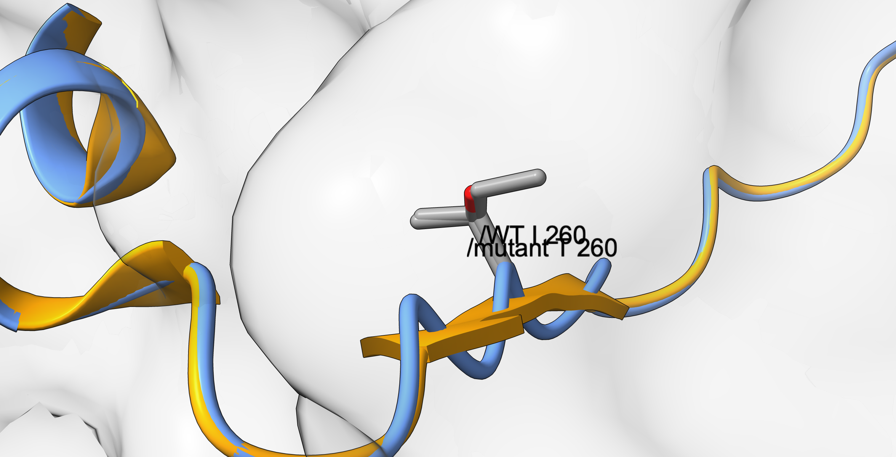
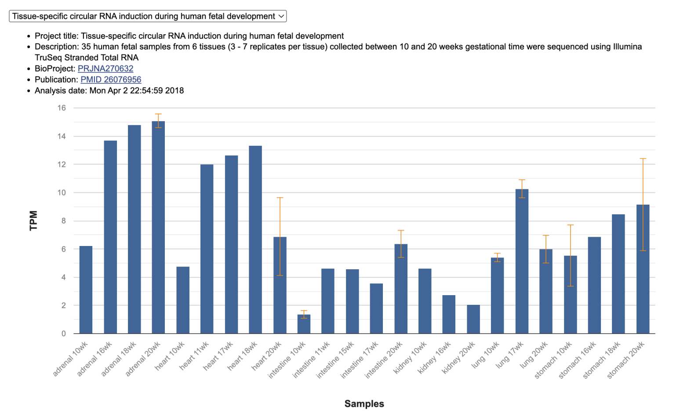
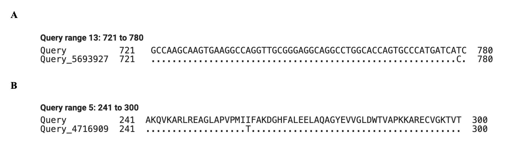

# Porphyria Cutanea Tarda Type 2 (PCT)

### Authors: Sara Charif Karkri and Laia Núñez

### _Bioinformatics, UPC, Barcelona, Spain_

## Abstract
Porphyria Cutanea Tarda Type 2 (PCT2) is an autosomal dominant metabolic disorder caused by a 50% reduction in uroporphyrinogen decarboxylase (UROD) enzyme activity. In this study, we performed comparative bioinformatic, sequence alignment, and 3D structural analyses to elucidate the molecular basis of a pathogenic UROD variant. Pairwise alignments of human wild-type and disease-associated coding DNA sequences (CDS) and protein chains revealed a single nucleotide transition (c.779C>T) resulting in a missense substitution (p.Ile260Thr). Evolutionary conservation analysis across Homo sapiens, Pan troglodytes, and Bacillus subtilis demonstrated high sequence preservation at the protein level (95% query coverage, E-value = 1e-77), contrasting with high CDS divergence, reflecting strong purifying selection to maintain core catalytic functions. 3D structural superposition yielded a global RMSD of 0.253 Å between wild-type and mutant human models, with a local backbone displacement of only 0.147 Å. These findings confirm that the pathogenic mechanism of the p.Ile260Thr variant is driven by local physicochemical disruption—substituting a buried hydrophobic isoleucine with a polar threonine in the internal core—rather than global structural distortion, destabilizing enzyme folding and disrupting heme biosynthesis.

## Keywords

Uroporphyrinogen decarboxylase (UROD), porphyria cutanea tarda type 2 (PCT), Basic Local Alignment Search Tool (BLAST), missense mutation, sequence conservation, penetrance.

## Background

Porphyria cutanea tarda type 2 (PCT) is a rare metabolic disorder characterized by a 50% reduction in the activity of the enzyme UROD (uroporphyrinogen decarboxylase) (Soufleris et al. 2024).

The principal function of this enzyme is to assist in the production of heme, an essential  component for creating hemoglobin (which gives blood its red color and transports oxygen) and for enabling the liver to eliminate toxins (Online Mendelian Inheritance in Man n.d.). Specifically, the protein UROD, encoded by the gene also called UROD, catalyzes the sequential decarboxylation of the four acetate side chains of uroporphyrinogen III to yield coproporphyrinogen III, an indispensable step in the heme biosynthesis pathway. Because this step is required for fundamental cellular metabolism, the enzyme is present in both prokaryotic and eukaryotic organisms (Whitby 1998).

This hereditary condition affects both men and women, as it is transmitted in an autosomal dominant pattern. This means that the gene responsible is located on a non-sex chromosome (autosome), and inheriting a single mutated copy of the UROD gene from either parent is sufficient to predispose an individual to the disease (MSD Manuals n.d.b).

Each child of a carrier has a 50% chance of inheriting the altered gene, and most carriers inherit it from a parent who is completely asymptomatic. The reason why carriers produce only 50% of the fully functional UROD enzyme is that cells use both copies of the gene (one from the father and one from the mother) and since one copy is defective, only half of the normal amount is produced (Soufleris et al. 2024).

### Clinical symptoms

The manifestations of this disease are mainly cutaneous and result from the accumulation of porphyrins (organic molecules involved in heme biosynthesis that do not contain iron). Accumulated porphyrinogens are oxidized to porphyrins, which deposit in the skin and, when activated by sunlight, generate reactive oxygen species that damage the skin (MSD Manuals n.d.a).

The most common symptoms are: extreme skin fragility (the skin erodes or peels off with minimal friction); blisters and vesicles that leave erosions, crusts and scars (appearing predominantly on sun-exposed areas such as the backs of the hands, forearms, and face); pigmentation changes (hyperpigmentation or hypopigmentation); dark reddish-brown urine and increased growth of fine hair, especially on the face (Orphanet n.d.).

### Penetrance

In hereditary type 2 PCT, the UROD deficiency is present in all body tissues, including red blood cells (National Center for Biotechnology Information n.d.), unlike type 1 (sporadic/acquired), in which the deficiency is restricted to the liver. In principle, this might suggest that anyone with the mutation would manifest symptoms of the disease; however, type 2 PCT involves a genetic phenomenon known as incomplete penetrance, where carrying the mutation does not guarantee the development of the pathology (The Medical Biochemistry Page n.d.).

Most individuals with the mutation are asymptomatic (latent carriers), and only a minority develop the disease. This occurs because the inherited mutation reduces UROD activity by half; however, under normal conditions this residual activity is sufficient for heme synthesis (American Porphyria Foundation n.d.).

For the disease to manifest clinically (presenting with characteristic symptoms such as skin fragility and blistering upon exposure to sunlight), the patient's liver must be exposed to environmental factors that cause hepatic enzyme activity to drop below 20-25% of normal  (MSD Manuals n.d.a).

### Risk factors

Studies show that, in the majority of cases, individuals who develop type 2 PCT have been exposed to factors that place oxidative stress on the liver, such as iron overload, excessive alcohol or tobacco use, chronic viral infections (e.g., hepatitis C or HIV), end-stage renal disease on hemodialysis, the use of estrogen-containing medications (contraceptives or hormone therapies), or exposure to industrial chemicals (Egger et al. 2002, International Porphyria Network n.d.).

### Diagnosis

PCT is diagnosed by measuring excess porphyrins in blood, urine (uroporphyrins), and stool (isocoproporphyrins) samples. Distinguishing type 1 from type 2 requires measuring erythrocyte UROD activity (reduced to ~50% in type 2, normal in type 1) and genetic testing of the UROD gene (Mayo Clinic n.d.).

### Treatment

The aim of PCT treatment is to lower the amount of porphyrins in the body. This is done in two ways: by reducing their production with venesection (regular removal of blood to lower iron levels, which allows the UROD enzyme to work again), or by helping the body eliminate them with low doses of chloroquine or hydroxychloroquine (International Porphyria Network n.d.).

It is also essential to avoid the factors that trigger the disease: stop drinking alcohol and smoking, stop taking estrogens, avoid iron supplements, and treat underlying conditions such as hepatitis C. Patients must also protect their skin from sunlight with clothing and physical sunscreens (Egger et al. 2002).

### Sequence analysis

Because type 2 PCT originates from mutations in the UROD gene, analyzing the mutated sequence can help explain how a single genetic change reduces the activity of the enzyme. Biological sequences can be compared to identify similarities and differences. Sequence comparison with BLAST makes it possible to identify unknown DNA and protein sequences, to locate the variant that distinguishes a disease-associated sequence from the wild-type (WT) sequence, and to search for homologous sequences in other species. Conserved positions, which have remained similar during evolution, can indicate regions that are important for protein structure or function.

### Aims of the study

The aims of this study were therefore: to identify the gene and protein corresponding to the wild-type coding sequence (CDS) and protein sequences provided for the project; to confirm the identity of the mutant sequences and to characterize the variant at the nucleotide and amino-acid levels; and to examine whether the variant lies in a region conserved across species, as a first step towards explaining its pathogenic effect.

## Results
### 3D Mutation Mapping and Local Conformational Impact
Structural evaluation of the disease-associated variant at position 260 reveals a missense substitution replacing the wild-type isoleucine with a threonine (p.Ile260Thr). Superposition of the human wild-type and mutant 3D structures demonstrates minimal backbone distortion, yielding a global RMSD of 0.253 Å and a local Cα backbone displacement of only 0.147 Å at position 260. At the corresponding aligned position in the bacterial ortholog (Bacillus subtilis), the residue is occupied by a methionine with a local backbone displacement of 1.329 Å.

**Figure 3.** Local 3D structural superposition centered at position 260 of human uroporphyrinogen decarboxylase (UROD). The ribbon backbone shows the wild-type model superimposed on the mutant model, highlighting the substituted side chains within the internal protein pocket (local Cα displacement = 0.147 Å). Image generated from the interactive course web interface provided by the Introduction to Bioinformatics course instructors (UPC, 2026).

### Identification and Genomic Context of the Gene and Protein

The protein identified directly corresponds to the gene found in the WT CDS search, as the functional uroporphyrinogen decarboxylase enzyme is translated directly from this genetic sequence. Following standard nomenclature, both the gene and its protein share the symbol **UROD**. Located on chromosome 1 at position 1p34.1 (genomic reference NC_000001.11), the **UROD** gene consists of 10 exons. Gene expression analysis shows active transcription across major human fetal tissues—including the heart, kidneys, lungs, stomach, intestines, and adrenal glands—highlighting its essential role in early development.

**Figure 1.** Expression of UROD (transcripts per million, TPM) in 35 human fetal samples from six tissues collected between 10
and 20 weeks of gestation. Bars show the mean per tissue and time point. Source: National Center for Biotechnology Information (n.d.).

### Sequence Alignment and Mutation Characterization
A pairwise alignment confirms that the mutant CDS originates from the exact same genetic locus as the wild-type CDS, showing complete query coverage, an E-value of zero, and 99.91% sequence identity. The only discrepancy between the two sequences is a single nucleotide substitution at position 779 of the query sequence (position 791 of the subject sequence), where the wild-type cytosine (C) is replaced by thymine (T) (c.779C>T). Evaluating this substitution within its codon reading frame reveals a missense mutation that changes codon 260 from ATC to ACC, thereby substituting isoleucine with threonine. At the protein level, the alignment confirms that the mutant protein matches wild-type UROD with full query coverage, an E-value of zero, and 99.73% sequence identity, differing solely by a single amino acid substitution (p.Ile260Thr) at position 260. No nucleotides were inserted or deleted, so the reading frame is preserved and no frameshift occurs.

The variant at the CDS level is therefore a single nucleotide substitution, while at the protein level it results in a single amino-acid substitution, replacing a large, hydrophobic isoleucine with a smaller, polar threonine at position 260. A minor point mutation in the genetic code thus leads to a significant change in the physical and chemical properties of the protein chain.

**Figure 2.** Pairwise BLAST alignments of WT (Query) and mutant sequences, query-anchored with dots for identities. A) CDS positions 721–780: the WT thymine at position 779 is replaced by cytosine (c.779T>C). (B) Protein positions 241–300: isoleucine 260 is replaced by threonine (p.Ile260Thr).

### Multi-Species Sequence Conservation Analysis

Analysis of sequence conservation across the three species demonstrates that conservation is not uniformly distributed. Homologous WT sequences were retrieved from _Bacillus subtilis_ (the assigned species) and _Pan troglodytes_ (the additional species) and aligned with the human sequences. Aligning human coding sequences against Pan troglodytes shows high sequence identity ranging between 96% and 99% with zero alignment gaps, consisting exclusively of single nucleotide substitutions. In contrast, alignment with Bacillus subtilis CDS is restricted to a small local fragment spanning only 12% query coverage with 67.15% identity and explicit structural gaps. Across protein sequences, high conservation is maintained between humans and chimpanzees over the full length of the chain with 99.73% identity and a single substitution at position 208. The protein alignment against Bacillus subtilis covers 95% of the sequence length with an E-value of 1e-77, 38.70% identity, and 17 gap positions resulting from insertions or deletions. Consequently, there are no highly conserved CDS regions shared across all three species simultaneously.

## Discussion
### Physicochemical and Structural Pathomechanism of p.Ile260Thr
Comparing the physicochemical properties of the wild-type and mutated residues explains the molecular mechanism of Porphyria Cutanea Tarda Type 2. Wild-type isoleucine is a large, non-polar, aliphatic residue buried within the internal hydrophobic core to stabilize tertiary folding through hydrophobic interactions. The p.Ile260Thr substitution introduces a smaller, polar threonine residue containing a hydrophilic hydroxyl (-OH) group into this buried non-polar environment. Because the local Cα backbone displacement is minimal (0.147 Å), the pathogenic mechanism is not driven by large structural distortion of the protein backbone. Instead, pathogenicity originates from local physicochemical disruption: the polar hydroxyl group disrupts internal hydrophobic packing and alters local hydrogen-bonding networks, destabilizing tertiary folding and impairing UROD catalytic activity below the threshold required for normal heme biosynthesis.

### Physicochemical and Functional Impact of the Variant

Evaluating side-chain properties reveals that while both isoleucine and threonine carry a net neutral charge at physiological pH, isoleucine possesses a larger four-carbon non-polar hydrocarbon side chain, whereas threonine contains a smaller two-carbon side chain with a polar hydroxyl group. Hydrophobic isoleucine residues are normally buried inside the internal core of the protein to stabilize its tertiary structure through hydrophobic interactions. Introducing a hydrophilic threonine residue introduces a polar hydroxyl group into this internal core, disrupting hydrophobic interactions and perturbing hydrogen-bonding networks. This structural disturbance forces the protein chain to refold incorrectly, destabilizing the enzyme and impairing catalytic activity, which directly contributes to the pathogenic mechanism of porphyria cutanea tarda.

### Evolutionary Divergence and Functional Constraints

Not all nucleotide variants lead to amino acid substitutions, as the degeneracy of the genetic code allows synonymous mutations to accumulate without altering the translated protein. Consequently, the three species show higher sequence similarity at the protein level than at the CDS level. 

## Conclusions
This study clarifies the molecular pathomechanism of Porphyria Cutanea Tarda Type 2 associated with the UROD p.Ile260Thr variant. Bioinformatic analysis confirmed that the disease originates from a single c.779C>T nucleotide transition. Cross-species comparative alignment demonstrated that while coding DNA sequences diverge significantly over evolutionary time, the UROD protein structure is constrained by strict purifying selection to preserve heme biosynthesis. 3D structural modeling proved that the p.Ile260Thr mutation causes minimal global backbone distortion (RMSD = 0.253 Å). Instead, pathogenicity is driven by the introduction of a hydrophilic hydroxyl group into the buried non-polar core, disrupting internal hydrophobic interactions, destabilizing enzyme folding, and impairing catalytic activity below the clinical penetrance threshold.

## Methods
### 3D Structural Modeling and Superposition
Three-dimensional structural superpositions, root-mean-square deviation (RMSD) calculations, and local Cα backbone displacements were evaluated using the interactive web-based structural visualization module provided by the course instructors for the Introduction to Bioinformatics course (Universitat Politècnica de Catalunya, 2026).

### Data sources

The CDS and protein sequences corresponding to the wild-type (WT) and mutant variants were initially provided in FASTA format. To carry out the research, a series of searches was performed in the NCBI nucleotide and protein databases. Among the highest-scoring results, curated NCBI Reference Sequence (RefSeq) entries (NM_ for mRNA and NP_ for protein accessions) were prioritized over predicted entries (XM_ and XP_). The gene locus, chromosome, number of exons, and tissue expression were obtained from the NCBI Gene record linked to the selected RefSeq entries.

### Implementation

The WT and mutant CDS were searched with BLASTn and the WT and mutant proteins with BLASTp using default parameters in both cases. To identify homologs, the searches were repeated using the human WT sequences as queries, and the search was restricted to the organism Bacillus subtilis (the assigned species) or Pan troglodytes (the additional species). Finally, the homologous CDS and protein sequences were downloaded in FASTA format for further analysis. Pairwise comparisons (WT vs. mutant) and cross-species comparisons were performed with the BLAST 'Align two or more sequences' option, and alignments were inspected in the 'Query-anchored with dots for identities' view. Variants were annotated with the c. (CDS) and p. (protein) notations.

### Statistical Analysis

Each hit was evaluated by combining query coverage (percentage of the query included in the alignment), percent identity (percentage of identical aligned positions), and E-value (number of matches of similar quality expected by chance in a database of that size), together with the sequence description, organism, and accession type. Additionally, side-chain physicochemical properties (size, charge, polarity and hydrophobicity) were evaluated to predict the effect of the amino-acid substitution on UROD structure and activity, and thus its potential role in the pathogenesis of porphyria cutanea tarda type 2 (PCT).

## Abbreviations

BLAST: Basic Local Alignment Search Tool; CDS: coding DNA sequence; NCBI: National Center for Biotechnology Information; PCT: porphyria  cutanea tarda; RefSeq: NCBI Reference Sequence; UROD: uroporphyrinogen decarboxylase; WT: wild type.

## Declarations
### Ethics approval and consent to participate
Not applicable. This study utilizes publicly available, anonymized bioinformatic and genomic database sequences.

### Consent for publication
Not applicable.

### Availability of data and materials
All sequence files, 3D structural models, alignments, and project code are available in the public GitHub repository: https://github.com/sara-charif-karkri/12DP-E_PCT_IB_2026.git

### Competing interests
The authors declare that they have no competing interests.

### Funding
This work was supported by the Undergraduate Bioinformatics Project curriculum at Universitat Politècnica de Catalunya (UPC).

### Authors' contributions
- **Laia Núñez Palma:** Conducted disease background research, clinical characterization, penetrance, and risk factor analyses.Performed pairwise CDS/protein alignments, multi-species conservation analyses, and mutation mapping.
- **Sara:** Retrieved and validated FASTA datasets, curated NCBI RefSeq entries, selected species orthologs, and gathered PDB structures.Performed local physicochemical cavity analysis. Managed project timeline, Gantt tracking, GitHub repository administration, and final report compilation.

All authors read and approved the final manuscript.

### Acknowledgements
We thank the course instructors of Introduction to Bioinformatics (UPC) for providing the initial FASTA sequence datasets and the interactive HTML structural visualization interface used for the 3D conformational analysis.

## References
- American Porphyria Foundation. Porphyria Cutanea Tarda (PCT). https://porphyriafoundation.org/for-patients/types-of-porphyria/pct/ (12 October 2026, date last accessed).
- Egger NG et al. Porphyria cutanea tarda: multiplicity of risk factors including HFE mutations, hepatitis C, and inherited uroporphyrinogen decarboxylase deficiency. Dig Dis Sci 2002;47:419–26.
- International Porphyria Network. Porphyria Cutanea Tarda (PCT). https://ipnet.org/porphyria-cutanea-tarda-pct-2/ (12 October 2026, date last accessed).
- Mayo Clinic. Porphyria: Diagnosis & treatment. https://www.mayoclinic.org/diseases-conditions/porphyria/diagnosis-treatment/drc-20356072 (12 October 2026, date last accessed).
- MSD Manuals. Overview of Cutaneous Porphyrias. https://www.msdmanuals.com/professional/hematology/the-porphyrias/overview-of-cutaneous-porphyrias (12 October 2026, date last accessed).
- MSD Manuals. Porphyria Cutanea Tarda. https://www.msdmanuals.com/professional/hematology/the-porphyrias/porphyria-cutanea-tarda (12 October 2026, date last accessed).
- National Center for Biotechnology Information. UROD uroporphyrinogen decarboxylase [Homo sapiens (human)]. https://www.ncbi.nlm.nih.gov/gene/7389 (9 October 2026, date last accessed).
- Online Mendelian Inheritance in Man. Porphyria cutanea tarda; PCT. https://www.omim.org/entry/176100 (11 October 2026, date last accessed).
- Orphanet. Porphyria cutanea tarda. https://www.orpha.net/en/disease/detail/101330 (12 October 2026, date last accessed).
- Soufleris S et al. Novel UROD mutation for porphyria cutanea tarda, type 2: a case report. AME Case Rep 2024;8:67.
- The Medical Biochemistry Page. Porphyria Cutanea Tarda, PCT. https://themedicalbiochemistrypage.org/porphyria-cutanea-tarda-pct/ (12 October 2026, date last accessed).
- Whitby FG et al. Crystal structure of human uroporphyrinogen decarboxylase. EMBO J 1998;17:2463–71.
